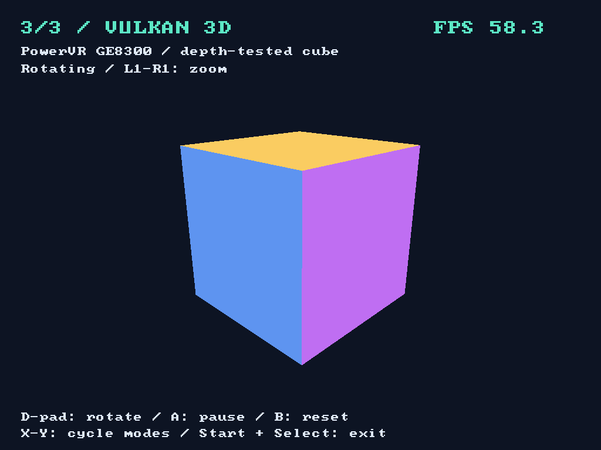
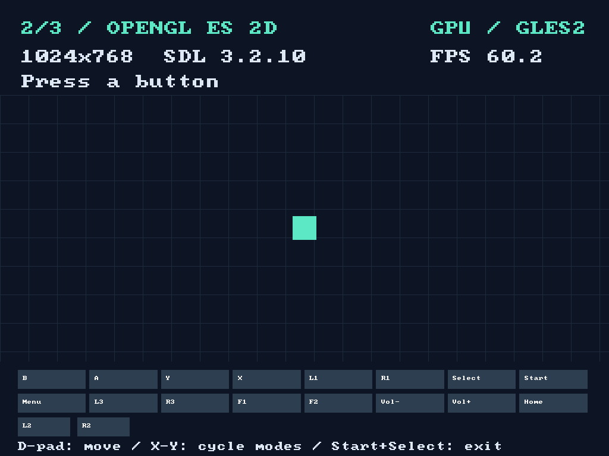
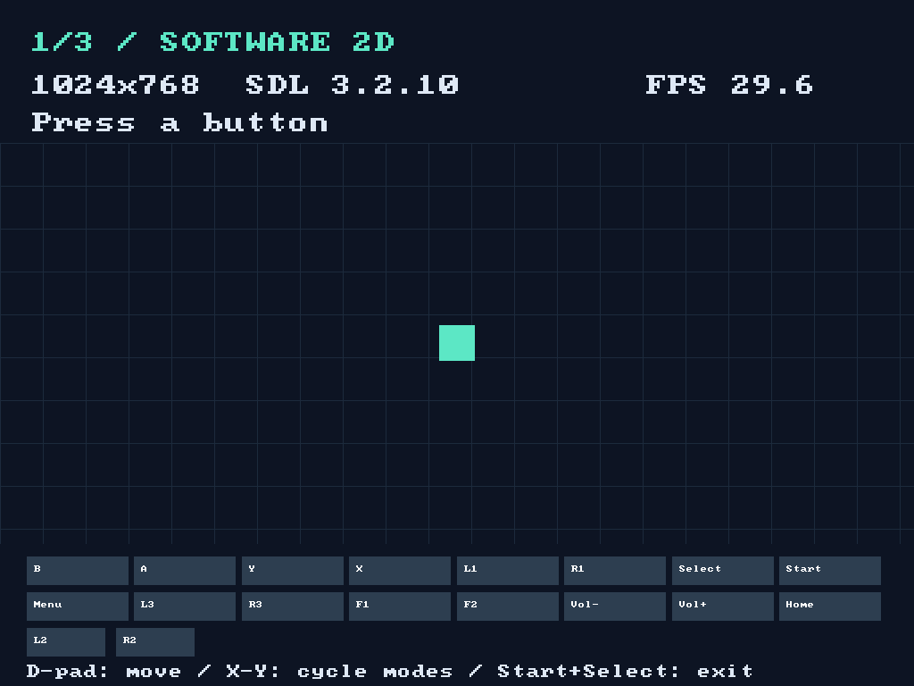

# Handkit

Build native **SDL3** apps and games for Linux handhelds such as the TrimUI Brick Pro and the Anbernic RG35XX family, from macOS or Linux, with one command.

Handkit gives you a pinned cross-compiler, SDL3 with display backends for the handhelds' GPU drivers, a small C helper library for controls, menus, sleep and rumble, and packaging for the handheld firmwares. Your app runs natively on the device, with OpenGL ES 2D or Vulkan 3D through SDL's GPU API.

```sh
./tools/handkit build      # cross-compile the demo for ARM64
./tools/handkit deploy     # copy it to the handheld over USB
```

| Vulkan 3D | OpenGL ES 2D | Software 2D |
| :---: | :---: | :---: |
|  |  |  |

The demo's three rendering modes on a TrimUI Brick Pro (1024×768), captured on the device.

## Handkit and PortMaster

[PortMaster](https://portmaster.games) installs and launches ports (games and apps adapted to these devices) on almost every custom firmware. Handkit doesn't replace it; the two cover different steps:

- **PortMaster is the app store.** It distributes ports and, when one launches, detects the device and firmware, sets up the controls and starts it.
- **Handkit is the developer kit, like Xcode or Android Studio.** It's what you use on your computer to *make* the app: compiler, libraries, a starter project, and packaging.

| Step | Handkit | PortMaster |
| --- | :---: | :---: |
| Write the app, with helpers for controls, menu, sleep, rumble | ✓ | |
| Cross-compile for the handheld's ARM chip, no chroot or Docker | ✓ | |
| Run SDL3 natively on the GPU, including Vulkan | ✓ | |
| Read each firmware's controller layout | ✓ | ✓ |
| Package the app | ✓ | |
| Publish, download, install and update | | ✓ |
| Launch on the device | NextUI `.pak` | ✓ |

Today, porters do the left column by hand: a Debian chroot, a cross-compiler, a self-built SDL, a guessed glibc version, a launch script per firmware. Handkit replaces that with one reproducible build. Packaging Handkit apps as PortMaster ports is planned, so they reach every firmware PortMaster supports. Until then, apps ship as NextUI `.pak` folders.

## What's included

| Component | What it does |
| --- | --- |
| **Toolchain** | A pinned, checksum-verified Zig/Clang 19 cross-compiler that builds ARM64 Linux binaries against glibc 2.33, so they run on old and new firmwares alike. Runs on macOS and Linux, ARM64 and x86_64. |
| **SDL3** | SDL 3.2.10 with a fullscreen backend for the handhelds' framebuffer GPU drivers: PowerVR on TrimUI's A133P, Mali on Anbernic's H700. Statically linked; the firmware provides only glibc and the GPU driver. |
| **Helper library** | Controls through SDL's gamepad mapping, a NextUI-style in-game menu, power button, sleep and the volume bar, LEDs and rumble. |
| **Packaging** | `hk_add_pak()` in CMake builds a NextUI/MinUI `.pak` folder; `tools/handkit deploy` installs it over USB. |
| **Starter and demo** | A minimal app to copy, and a demo that switches between software, OpenGL ES 2D and Vulkan 3D rendering. |

## Project structure

```text
handkit/
├── tools/
│   ├── handkit            Command-line tool: configure, build, init, deploy, run, logs
│   └── package-release.sh Zips the builds for releases
├── sdk/                 The helper library apps link against
│   ├── include/handkit/   Public C headers: runtime, input, menu, system, feedback
│   ├── src/               Their implementation
│   └── cmake/             hk_add_pak() and the .pak launcher script
├── src/platform/        SDL3 display backend for the handhelds' GPU drivers
├── recipes/             Conan recipes for Handkit's packages
│   ├── handkit-toolchain/ Downloads the pinned Zig compiler and sets it up for ARM64
│   ├── handkit-sdl/       Downloads SDL3 and compiles it with the display backend
│   └── handkit/           Builds the helper library from sdk/
├── profiles/aarch64     Conan profile describing the handheld: ARM64 Linux, glibc 2.33
├── examples/
│   ├── demo/              Demo app: software, OpenGL ES 2D and Vulkan 3D modes
│   └── minimal/           Starter project that tools/handkit init copies
├── tests/               Input self-test, and the device test package for testers
├── docs/                Guides: getting started, API, platforms, architecture
├── conanfile.py         Dependencies of the demo and examples in this repository
├── conan.lock           Exact versions of every dependency, for reproducible builds
└── CMakeLists.txt       Builds the demo, the starter and the self-test
```

The packages in `recipes/` aren't published to a Conan remote yet; `tools/handkit configure` builds them into your local Conan cache, where apps can depend on `handkit/0.4.0`.

## Supported devices

| Device | Chip | Firmware | Status |
| --- | --- | --- | --- |
| TrimUI Brick Pro | Allwinner A133P | NextUI | **Tested on device:** all three rendering modes, controls, Start + Select, volume bar. |
| TrimUI Brick, Smart Pro | Allwinner A133P | NextUI, stock, CrossMix, spruce | Same system and drivers as the Brick Pro; not yet tested. |
| TrimUI A133P handhelds | Allwinner A133P | knulli, muOS | Graphics stack and glibc checked from the firmwares' source; not yet tested. |
| Anbernic RG35XX, RG40XX, RG34XX, RG CubeXX (H700) | Allwinner H700 | knulli, muOS | **New, untested.** Mali backend and controller mapping written from the firmwares' source. Vulkan availability unknown. |
| Anbernic H700 | Allwinner H700 | stock, MinUI | Not supported yet: these run a 32-bit system, Handkit builds 64-bit. |

See [docs/platforms.md](docs/platforms.md) for the evidence behind each entry and what's still open.

### Test your device

No build needed. Download the device test from the [latest build](https://github.com/code-beans/handkit/releases/tag/latest-build) or a [release](https://github.com/code-beans/handkit/releases):

- `handkit-test-nextui-*.zip` for TrimUI handhelds with NextUI or MinUI,
- `handkit-test-ports-*.zip` for knulli, muOS and other firmwares with a ports menu.

Copy it to the SD card as its `README.txt` describes and start **Handkit Test** from the handheld's menu. It runs the input self-test and the demo, writes `handkit-report.txt`, then leaves the demo open for a minute for checking the buttons. Attach the report to a [device report](https://github.com/code-beans/handkit/issues/new?template=device-report.yml); failed runs help as much as working ones.

## Quick start

Install Python 3, [Conan](https://conan.io) 2.33+ and CMake 3.24+. For USB deployment, also install Android platform-tools (`adb`) and enable USB ADB on the handheld. On macOS:

```sh
brew install conan cmake android-platform-tools
```

Build and install the demo, then open **Tools → SDL3 Demo** on the handheld:

```sh
./tools/handkit build
./tools/handkit deploy
```

The first build downloads the compiler and builds SDL and the shader compiler, so it takes a few minutes. Later builds reuse Conan's cache.

Start your own app from the starter template:

```sh
./tools/handkit configure
./tools/handkit init ../my-app
```

[docs/getting-started.md](docs/getting-started.md) walks through building, deploying and debugging your own app.

## Documentation

- [Getting started](docs/getting-started.md): requirements, the demo, your first app, packaging, running and debugging.
- [API guide](docs/api.md): rendering, input, the in-game menu, system controls, LEDs and rumble.
- [Platforms](docs/platforms.md): devices, firmwares, support tiers and the evidence for each.
- [Architecture](docs/architecture.md): how the toolchain, SDL backend and packages fit together, and how to maintain them.
- [Contributing](CONTRIBUTING.md): reporting device results, adding a controller, code style, releases.

## Status

Handkit is young and its API may still change before 1.0. Audio is not wrapped: use SDL3's audio API directly.

## License

Handkit is released under the [MIT License](LICENSE). SDL is under the zlib license; Zig is under the MIT License. The GPU drivers are part of each handheld's firmware and are not redistributed.
